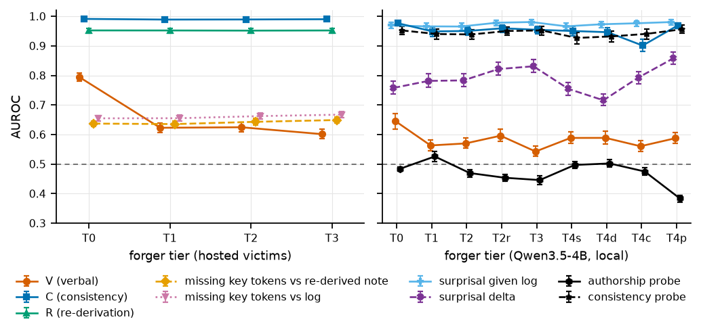

# Whose Memory Is This?

**What AI agents do with their own notes, and whether they can tell when someone else wrote them.**

Research code, data and paper for the Apart Research *AI x Epistemics* sprint (13–15 Nov 2026).
Paper: [`paper/main.pdf`](paper/main.pdf). Pre-registration: [`PREREGISTRATION.md`](PREREGISTRATION.md). Decision log: [`DECISIONS.md`](DECISIONS.md).



## Summary

An agent that keeps notes across sessions has to decide how far to believe them, and anyone who can write to
the memory store can replace a note. We measured what agents do with a note labelled as their own, whether they
can tell it from a forgery, and which check can. Five hosted open-weight models (six in the channel experiment)
and one local 4B model were tested, each response a single call without extended reasoning. The design was
pre-registered; a 40-hour outage of the machine forced a documented cut of the sample.

1. **Agents do not over-trust a note they can see contradicted.** Against a conflicting tool output they flag
   the conflict in 61.3% of trials, follow the tool in 37.9% and the note in 0.6% (registered estimand
   −37.4 pp, 95% CI [−43.3, −31.7]). Our hypothesis of over-trust was wrong in sign.
2. **Unchallenged, the note is taken as given.** A forged note with a swapped fact steers the downstream
   decision in 93.2% of cases; over all five edit types the rate is 60.7% (forger tier T2).
3. **Inspection misses the edits that work.** Asked which entries they wrote, models separate forged from
   genuine notes with an AUROC of 0.62 [0.61, 0.64], and 0.50 for swapped facts. A forgery in the victim's own
   style is caught no less often than any fluent rewrite (0.62 both), so there is no self-recognition to defeat.
   Another model's accurate note in the store is rated as the agent's own (AUROC 0.46 to 0.60). Shown the
   genuine and the forged version side by side, agents pick the genuine one in 80.8% of pairs, and in 52.8%
   for swapped facts.
4. **The signal is in the session log.** The same audit with the log attached reaches 0.99 (gap to the verbal
   audit at T3: 0.39 [0.37, 0.41]). On the local model, token surprisal of the note given the log reaches 0.97
   and survives a forger that selects against it; a probe that identifies the model's own notes is at chance
   on forgeries.
5. **A gate built on the log audit removes the attack while the log is intact** (attack success reduced by
   97.6% [96.3, 98.7]). An unsigned author tag changes nothing (1.3%), and with a verified signature shown as
   invalid agents still act on the forged note in 26.5% of cases. A forger who holds the signing key is not
   stopped at all (60.1%, against 60.7% with no defence).

The gate result is an upper bound: the log is assumed intact and no forger wrote for the auditor.

| Registered primary estimand | Criterion | Estimate [95% CI] | Holm p | Met |
|---|---|---|---|---|
| Self-trust premium (memory − tool, pp) | H1: > 0 | −37.4 [−43.3, −31.7] | 0.004 | no |
| Verbal recognition AUROC at T2 | H2: upper bound < 0.65 | 0.62 [0.61, 0.64] | 0.004 | yes |
| Integrity gap AUROC at T3 | H3: > 0 | 0.39 [0.37, 0.41] | 0.004 | yes |
| Gate: relative reduction of attack success (%) | H5: ≥ 50, lower bound > 0 | 97.6 [96.3, 98.7] | 0.004 | yes |

All numbers above are generated by `analysis/` and appear in `results/analysis/main/SUMMARY.md` and
`paper/numbers.tex`.

## What is in the study

An agent that works across sessions writes a note at the end of each session and reads its notes back at the
start of the next. `memlab` generates such tasks with exact ground truth: three task families, seven sessions
per episode, one note per session. A forger replaces one of the seven notes. Forger tiers: T0 template edit,
T1 rewrite by a model from another family, T2 rewrite by the victim model in its own style, T3 best of eight
T2 candidates by the victim's own rating, T4 optimised against the local model's detectors.

| Pillar | Question | Where |
|---|---|---|
| P1 | How does an agent weigh its own note against a tool output, a user message, a web snippet, another agent, a document, or an unattributed line? | `experiments/p1_self_trust.py` |
| P2 | Can the agent say which notes it wrote? (verbal audit V) | `experiments/hosted_detect.py` |
| P3 | Is there a signal elsewhere? Consistency against the session log (C), re-derivation (R), surprisal and probes on a local model | `experiments/hosted_detect.py`, `experiments/local_pipeline.py` |
| P4 | Does a gate that checks against the log (G1), or an unsigned / signed author tag (G2u / G2s), stop the attack? | `experiments/p4_gate.py` |

Hosted models (through one inference API, extended reasoning off): `deepseek-v4-flash`, `qwen3.8-27b`,
`gemma-4-31b-it`, `glm-5.3-flash`, `glm-5.2`; `qwen3.5-397b` in P1 only. Local model: `Qwen/Qwen3.5-4B` on
Apple MPS.

## Quick start: reproduce every number, figure and table

No API key and no GPU are needed. The processed model outputs are in the repository. The local-model results
are kept as committed (`results/analysis/local.json`), because the pooled activations behind the probes (about
300 MB) are not in the repository; `python -m experiments.local_pipeline score` regenerates them on a GPU.

```bash
git clone https://github.com/timwuerfl/whose-memory.git && cd whose-memory
python3.12 -m venv .venv && .venv/bin/pip install -r requirements.txt
.venv/bin/python -m analysis.reproduce --run main   # results/analysis/main/, paper/figures, paper/tables, paper/numbers.tex
.venv/bin/python -m analysis.check_numbers          # every number in the paper is a macro from the analysis
make test                                           # unit tests, no network
make paper                                          # needs tectonic (https://tectonic-typesetting.github.io)
```

`results/analysis/main/SUMMARY.md` is a plain-text digest of the main results, and
`results/analysis/main/numbers_index.md` lists every macro used in the paper with its value and source.

`torch` and `transformers` in `requirements.txt` are only needed for the local-model pipeline and its tests;
the analysis runs without them if you remove the two lines.

## Re-running the experiments

This needs an Adaption Labs API key (two keys are used in parallel if present). Copy `.env.example` to `.env`
and fill in the keys. `.env` is ignored by git.

```bash
.venv/bin/python -m experiments.hosted_gen     --run main      # notes and forgeries T0-T3
.venv/bin/python -m experiments.hosted_detect  --run main      # audits V, C, R
.venv/bin/python -m experiments.p1_self_trust  --run main      # channel experiment
.venv/bin/python -m experiments.p4_gate        --run main      # gate and tags
.venv/bin/python -m experiments.local_pipeline notes           # local model: see experiments/README.md
```

Every stage is resumable and caches by request hash. `experiments/run_remaining.sh` is the driver that was
used for the last eleven hours of collection, after the outage described in `DECISIONS.md`, and
`experiments/run_stretch2.sh` ran the control conditions and the balanced secondary channel trials.
`python -m experiments.status` prints progress, spend and rate-limit state.

## Repository map

```
memlab/          environment (env/), prompts, forgers (attacks/), detectors, defences, API client with spend ledger
experiments/     runners for each stage; README.md documents their options
analysis/        processed rows -> estimates, figures, tables, paper/numbers.tex (reproduce.py runs all of it)
paper/           LaTeX source and main.pdf
data/episodes/   the frozen episodes (pilot and main seeds are disjoint)
results/raw/         one JSONL row per model call, including pilots and the rows set aside under amendment 2
results/processed/   tidy per-stage files the analysis reads
results/analysis/    estimates (hosted.json, local.json), SUMMARY.md, figure previews
results/spend_ledger.csv   every billed call with tokens and cost
tests/           unit tests
```

## Cost

Total API spend: **$27.06** for 65,379 billed calls (limit: $1,500), all at one hosted inference provider
(Adaption Labs). No other paid service was used. Local-model work ran on an Apple M4 Pro laptop.

| Stage (main run) | Calls | Input tokens (M) | Output tokens (M) | Cost ($) |
|---|---|---|---|---|
| Notes and forgeries (`hosted_gen`) | 13,126 | 9.81 | 4.69 | 6.42 |
| Audits V, C, R and controls (`hosted_detect`) | 16,606 | 26.87 | 2.38 | 7.59 |
| Channel experiment (`p1_pairs`) | 16,262 | 5.06 | 1.26 | 3.07 |
| Gate and tags (`p4_gate`) | 13,578 | 21.58 | 2.01 | 8.41 |
| **Whole ledger, including pilots and set-aside rows** | 65,379 | 67.56 | 15.25 | 27.06 |

The ledger is `results/spend_ledger.csv`; the table is regenerated as `paper/tables/cost.tex`.

## Honest limits

The environment is synthetic, the stores are short, exactly one note is forged, and all hosted calls ran with
extended reasoning off. A 40-hour outage of the machine forced a cut of the registered sample; what was cut and
when is in `DECISIONS.md` and in the paper's appendix. The appendix section "Limitations & Dual-Use
Considerations" lists the rest.

## Licence

MIT, see [`LICENSE`](LICENSE).
